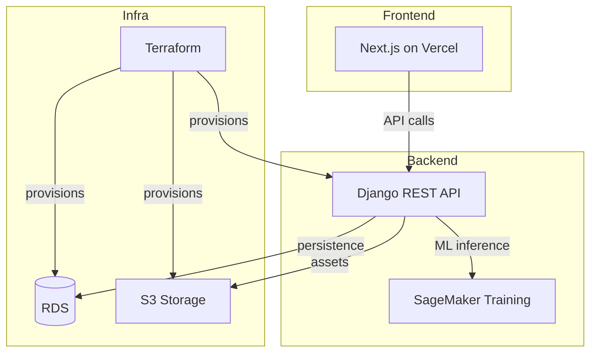

# Cookie — Django + Next.js + SageMaker Starter

Full-stack application template with Django REST backend, Next.js frontend, SageMaker ML training, and Terraform infrastructure on AWS/Vercel.



## Architecture

| Layer | Technology |
|-------|-----------|
| Frontend | Next.js (App Router), Tailwind CSS |
| Backend | Django 4.2 + Django REST Framework |
| ML | Amazon SageMaker |
| Infra | Terraform (AWS) + Vercel |
| CI/CD | GitHub Actions |

## Quick Start

### Prerequisites

- Python 3.9+
- Node.js 18+
- Docker (for database)

### Backend

```bash
cd backend
python -m venv .venv
source .venv/bin/activate
pip install -r requirements.txt  # or use your preferred tool

# Configure environment
cp ../.env.example .env.local

# Run migrations
python manage.py migrate

# Start server
python manage.py runserver
```

### Frontend

```bash
cd frontend
npm install
npm run dev
```

### Infrastructure

```bash
cd terraform
terraform init
terraform plan
terraform apply
```

## Project Structure

```
├── backend/          # Django project
│   ├── myproject/    # Settings, URLs, WSGI
│   ├── myapp_module1/  # Feature module 1
│   ├── sagemaker/    # ML training service
│   └── manage.py
├── frontend/         # Next.js app
├── terraform/        # AWS infrastructure
├── Django.Dockerfile
├── Nextjs.Dockerfile
└── pyproject.toml    # Python tooling config
```

## Quality Gates

- Python: Black + isort + pylint (see `pyproject.toml`, `.pylintrc`)
- Pre-commit: configured via `.pre-commit-config.yaml`

## Environment Variables

See `.env.example` for required variables. Never commit actual secrets.
